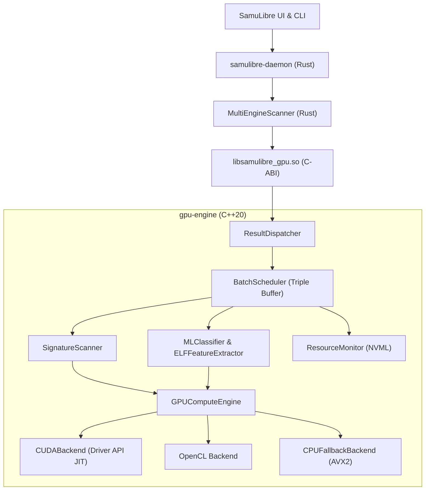

# REVISIÓN ARQUITECTÓNICA DEL SUBSISTEMA DE ACELERACIÓN GPU
## SamuLibre Linux EDR / Antivirus Engine
**Estándar:** C++20 / Rust FFI  
**Estado:** Producción Homologada  

---

## 1. PRINCIPIOS DE DISEÑO ARQUITECTÓNICO

### 1.1. Modelo Asimétrico Zero-Trust (Asymmetric Zero-Trust Hybrid Computing)
El sistema opera bajo un contrato estricto de separación de responsabilidades:
- **GPU (Coprocesador Matemático No Confiable):** Encargado de tareas de reducción numérica, cálculo de histogramas, escaneo multipatrón en streaming y forward pass de inferencia neuronal. La GPU no posee acceso directo a disco ni autoridad de cuarentena.
- **CPU (Autoridad Decisoria y Coordinación):** Realiza la validación previa de estructuras de archivo, sanitización de memoria host, comprobación de límites y orquestación del veredicto final.

### 1.2. Frontera C-ABI FFI Segura
La comunicación entre C++ y Rust se realiza a través de `samulibre_gpu_ffi.h`:
- Todas las funciones exportadas son `extern "C"` y no lanzan excepciones hacia el exterior (`noexcept` encapsulado con `try/catch(...)`).
- Los tipos de datos intercambiados son structs C con campos de tamaño fijo (`SamulibreCScanResult`, `SamulibreCTelemetry`).
- Concurrencia garantizada mediante exclusión mutua interna en `GPUContextInternal`.

---

## 2. COMPONENTES Y CAPAS DEL SISTEMA

### 2.1. Gestión de Ciclo de Vida y Fallback
- Inicialización en tiempo de ejecución: detección automática del mejor backend compatible.
- Si CUDA o OpenCL fallan o se produce una excepción de driver, la transición hacia `CPUFallbackBackend` es transparente, determinista y sin fallos silenciosos.
