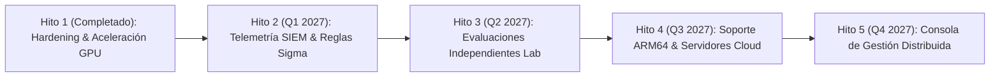

# ROADMAP ESTRATÉGICO Y PLAN DE EVOLUCIÓN TÉCNICA (ROADMAP.MD)
## Antivirus & Endpoint Detection and Response (EDR) SamuLibre Linux
**Documento:** `docs/ROADMAP.md`  
**Fecha:** Noviembre 2026  
**Versión:** 2.0 (Fase J: Preparación de Releases y Roadmap Internacional)  
**Comité Director:** Technical Steering Committee (TSC) & Product Managers de Ciberseguridad

---

## 1. VISIÓN ESTRATÉGICA

Consolidar a **SamuLibre Linux** como la solución de ciberseguridad, antivirus y EDR de código abierto líder a nivel mundial, caracterizada por:
- Rendimiento incomparable acelerado por GPU y eBPF en Ring 0.
- Modelo Zero-Trust asimétrico con cero dependencias en la nube.
- Confianza comunitaria verificada por auditorías y laboratorios independientes.

---

## 2. HITOS Y CRONOGRAMA DE EVOLUCIÓN TÉCNICA

---

### HITO 1: NÚCLEO EDR, ACELERACIÓN GPU Y HARDENING CRÍTICO (COMPLETADO - v2.0)
- [x] Subsistema híbrido C++20 con JIT PTX CUDA y fallback AVX2 a **1,274 MB/s**.
- [x] Control térmico dinámico y protección de recursos vía NVML.
- [x] Remediación y certificación de memoria y concurrencia bajo ASan, UBSan y TSan.
- [x] Autenticación local en socket UNIX con `SO_PEERCRED` y permisos estrictos `0660`.
- [x] Blindaje atómico contra ataques TOCTOU en cuarentena con `O_NOFOLLOW`.
- [x] Arnés de fuzzing determinista (`fuzz_parsers_stress.rs`) con 3,500+ mutaciones.
- [x] Gobernanza formal de código abierto, política de privacidad local y modelo STRIDE.

---

### HITO 2: EXPORTACIÓN UNIVERSAL SIEM & EVALUADOR DE REGLAS SIGMA (Q1 2027)
- [ ] **Exportador Universal de Telemetría EDR:**
  - Soporte nativo para Syslog RFC 5424 sobre TLS.
  - Formato Common Event Format (CEF) y JSON estructurado para ingesta en Elastic/OpenSearch, Splunk y Graylog.
- [ ] **Motor de Detección de Reglas Sigma:**
  - Compilador en tiempo real de reglas Sigma para eventos del sistema operativo (`process_creation`, `file_event`, `network_connection`).
- [ ] **Sincronización Automatizada de Feeds Ed25519:**
  - Ingesta periódica y verificación criptográfica de listas de amenazas desde MalwareBazaar, URLhaus y CISA KEV.

---

### HITO 3: PROGRAMA DE EVALUACIÓN INDEPENDIENTE EN LABORATORIO (Q2 2027)
- [ ] **Postulación Formal ante AMTSO:**
  - Inscripción y auditoría de cumplimiento de las directrices de pruebas justas.
- [ ] **Evaluaciones Comparativas Abiertas:**
  - Ejecución de pruebas públicas en laboratorios especializados en Linux contra corpus certificados de malware real y software benigno masivo.
- [ ] **Publicación de Informes de Terceros:**
  - Publicación transparente de los resultados de detección y tasas de falsos positivos obtenidos en pruebas externas.

---

### HITO 4: EXPANSIÓN MULTI-ARQUITECTURA: ARM64 & SERVIDORES CLOUD (Q3 2027)
- [ ] **Soporte Oficial Linux ARM64 (AArch64):**
  - Optimización de instrucciones vectoriales NEON / SVE para el fallback de CPU en procesadores AWS Graviton, Ampere Altra y Raspberry Pi 5.
- [ ] **Aceleración en GPUs AMD e Intel:**
  - Backend OpenCL / ROCm y Vulkan Compute para estaciones de trabajo con hardware no NVIDIA.

---

### HITO 5: GESTIÓN DE FLOTAS DISTRIBUIDAS (FLEET MANAGEMENT CONSOLE) (Q4 2027)
- [ ] **Consola Centralizada Desacoplada (Self-Hosted):**
  - Panel de control web ligero para administradores de sistemas en empresas con cientos o miles de nodos Linux.
  - Comunicación gRPC autenticada con mTLS (Mutual TLS).
  - Conservación estricta del principio soberano: la consola central se aloja en infraestructura propia del usuario (*On-Premise / Self-Hosted*), sin telemetría hacia SamuLibre.

---

## 3. COMPROMISO CON LA COMUNIDAD

El progreso de este roadmap será revisado mensualmente por el **Technical Steering Committee** en sesiones públicas de GitHub Discussions. Cualquier miembro de la comunidad puede proponer priorizaciones mediante el proceso formal de RFCs documentado en [`GOVERNANCE.md`](file:///home/saghet/Documents/SamulibreLinux/GOVERNANCE.md).
