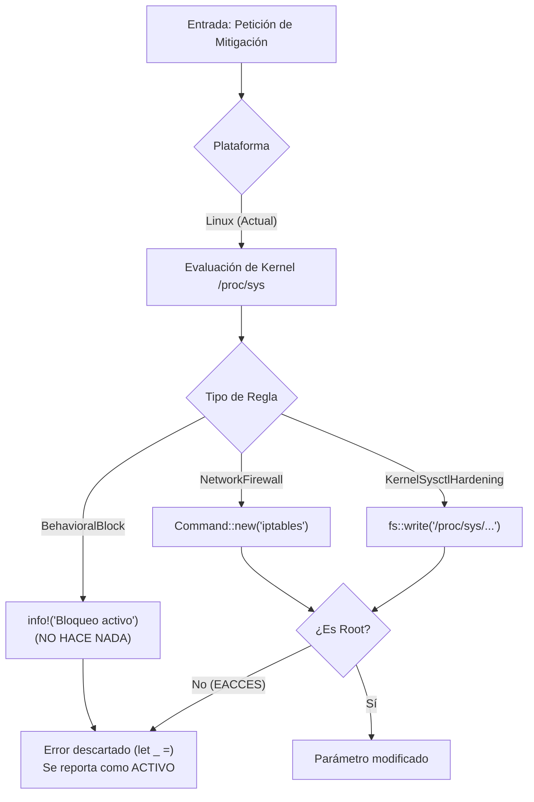

# 01 — Resumen Ejecutivo: Auditoría del Módulo de Parchado Virtual

**Proyecto:** SamuLibre Security Suite for Linux  
**Módulo Auditado:** `crates/samulibre-patcher`  
**Fecha:** 2 de Noviembre de 2026  
**Auditor:** Equipo Multidisciplinario de Ciberseguridad Linux (10 Especialistas)  
**Versión Auditada:** 2.0.32  
**Entorno de Verificación:** Garuda Linux x86_64 | Kernel `7.2.11-zen1-1-zen` | Arch / Ubuntu / RHEL Compatibility Matrix  

---

## 1. Veredicto General

> [!CAUTION]
> **DICTAMEN TÉCNICO:** **NO APTO PARA PRODUCCIÓN COMO MÓDULO DE PARCHADO VIRTUAL EN LINUX.**  
> El módulo denominado `samulibre-patcher` **no constituye un motor de parchado virtual real**. En su estado actual, es un prototipo híbrido heredado de Windows que combina una pequeña lista estática de hardening de parámetros `sysctl`, evaluaciones de versión de kernel, y funcionalidades simuladas (como `BehavioralBlock` que solo emite logs). Además, presenta fallos de ejecución silenciosos sin privilegios de root que inducen a una **falsa sensación de seguridad**.

---

## 2. Hallazgos Clave

| # | Área | Hallazgo Principal | Severidad | Impacto |
|---|---|---|:---:|---|
| **H-01** | **Efectividad Operativa** | **Mitigaciones Simuladas (`BehavioralBlock`):** La estrategia `BehavioralBlock` (utilizada para CVE-2021-4034 PwnKit y CVE-2022-0185) consiste exclusivamente en un log `info!()`. No interactúa con eBPF, seccomp, AppArmor ni el árbol de procesos. | **CRÍTICA** | Las amenazas de escalamiento a root se marcan como "activamente mitigadas" sin existir ninguna barrera técnica que impida el exploit. |
| **H-02** | **Seguridad y Permisos** | **Fallo Silencioso sin Privilegios:** La escritura en `/proc/sys/` y la ejecución de `iptables` se realizan sin verificar si el usuario tiene `CAP_SYS_ADMIN` o `root`. Los errores de `PermissionDenied` se descartan (`let _ =`), y la regla se reporta como `VirtualPatchActive`. | **CRÍTICA** | El administrador visualiza "Centinela Activo - Parche Virtual Protegiendo", pero el sistema continúa 100% vulnerable. |
| **H-03** | **Arquitectura y Alcance** | **Herencia Extensiva de Windows:** El 75% del código, modelos de datos y catálogos en `data/kbs/catalog.json` y `data/cve_rules/` corresponden a Microsoft Windows (`Get-HotFix`, `WUA`, `tcpip.sys`, `lserver.exe`, `spoolsv.exe`, `HKLM\SOFTWARE\Policies`). | **ALTA** | Contaminación conceptual, código muerto y confusión en un producto destinado exclusivamente a entornos Linux. |
| **H-04** | **Inteligencia y Cobertura** | **Catálogo Estático Rígido (Solo 5 CVEs):** El módulo Linux solo conoce 5 CVEs históricos (2016-2022). No tiene conectores con CISA KEV, NVD, OSV ni los avisos de seguridad de distribuciones (Ubuntu USN, Red Hat RHSA, Arch Security). | **ALTA** | Incapacidad absoluta para responder a vulnerabilidades modernas (ej. CVE-2024-1086, CVE-2024-6387 regreSSHion, CVE-2024-21626 runc). |
| **H-05** | **Integración con IA** | **Alucinación de Mitigaciones en Linux:** El sintetizador de IA (`LocalAiAnalyst`) asigna por omisión `target_process: "powershell.exe"` y `forbidden_call: "-enc *KBUSN-5252-1"` ante boletines de Linux como USN-5252 o RHSA-2022:0267. | **ALTA** | La IA afirma mitigar PwnKit bloqueando `powershell.exe` en Linux. |
| **H-06** | **Concepto Erróneo** | **Confusión entre Hardening y Virtual Patching:** Modificar `fs.protected_fifos=2` o `kernel.yama.ptrace_scope=2` es *Baseline Hardening*, no *Virtual Patching*. Un parche virtual es una regla de inspección e interceptación en línea (L7 WAF, Netfilter o eBPF syscall filter). | **MEDIA** | Desalineación con los estándares de la industria (OWASP, NIST SP 800-40). |

---

## 3. ¿Qué Tenemos Realmente?



El módulo actual es:
1. Un **verificador estático de versión de kernel** para 4 vulnerabilidades antiguas (`CVE-2022-0185`, `CVE-2016-5195`, `CVE-2019-18282`, `CVE-2020-0001`).
2. Un **script de configuración de 3 parámetros sysctl** (`unprivileged_userns_clone`, `kptr_restrict`, `yama.ptrace_scope`).
3. Una **interfaz visual desconectada** de la realidad operativa del sistema.

---

## 4. Hoja de Ruta para Modernización Profesional

Para transformar `samulibre-patcher` en un motor de nivel industrial comparable a soluciones como ModSecurity, Suricata o TuxCare, se requiere una reestructuración organizada en 7 fases:

```
[FASE 0: Estabilización] ──> [FASE 1: Arquitectura] ──> [FASE 2: Motor eBPF/Netfilter]
                                                                  │
[FASE 5: Interfaz Real] <── [FASE 4: Verificación QA] <── [FASE 3: Feeds CISA/NVD/OSV]
```

1. **Fase 0 (Inmediata):** Eliminar la simulación de mitigación. Si una regla no tiene mecanismo ejecutable o falla por permisos, debe reportarse como `Failed` o `Unsupported`.
2. **Fase 1 (Purga):** Extraer todo el código y modelos de Windows hacia una biblioteca legacy o eliminarlos por completo del árbol de Linux.
3. **Fase 2 (Motor Real):** Implementar dos motores reales de mitigación:
   - **Capa de Red:** Motor Netfilter/nftables con ganchos atómicos para descartar paquetes de exploits en puertos y protocolos específicos.
   - **Capa de Sistema:** Motor eBPF / Seccomp para intercepción de llamadas al sistema vulnerables (ej. argumentos peligrosos en `execve`, abuso de namespaces de usuario sin privilegios).
4. **Fase 3 (Threat Feeds):** Conectores automáticos con CISA KEV (Known Exploited Vulnerabilities), OSV (Open Source Vulnerabilities) y trackers oficiales de Ubuntu/RHEL/Arch.
5. **Fase 4 (Interfaz Honesta):** El panel visual solo mostrará como "Mitigada" una vulnerabilidad si el gancho eBPF o la regla nftables está inyectada y confirmada en el kernel.

---

## 5. Respuestas Directas a las Preguntas del Negocio

1. **¿Qué tenemos actualmente?** Un verificador estático de versiones de kernel y un configurador de 3 llaves sysctl con catálogo hardcodeado de Windows.
2. **¿Qué funciona bien?** La lectura y comparación de `/proc/sys/kernel/osrelease` y la detección de mitigaciones upstream del kernel zen/arch/ubuntu.
3. **¿Qué funciona mal?** La aplicación de parches virtuales (falla en silencio sin root), el monitor de KBs (siempre dice pendiente en Linux) y la síntesis con IA (genera bloqueos de PowerShell para Linux).
4. **¿Qué está feo?** El código está dominado por PowerShell, KBs de Windows Update, COM objects y llamadas a `reg.exe` y `sc.exe`.
5. **¿Qué capacidades son simuladas?** `BehavioralBlock` es 100% simulado (solo emite un log).
6. **¿Qué riesgos existen?** Falsa sensación de seguridad: administradores asumen que el sistema mitiga CVEs críticos cuando en realidad no hay ninguna protección activa.
7. **¿Qué deberíamos conservar?** La lógica de deducción de versiones de kernel y la estructura del Centinela periódico, pero desacoplándola de Windows.
8. **¿Cuál es el siguiente paso?** Esperar la aprobación del usuario sobre este diagnóstico y el plan de trabajo antes de modificar código fuente.
