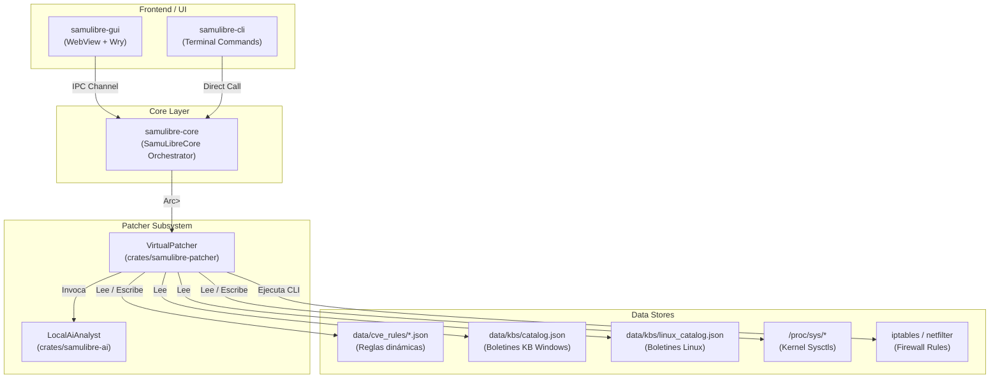
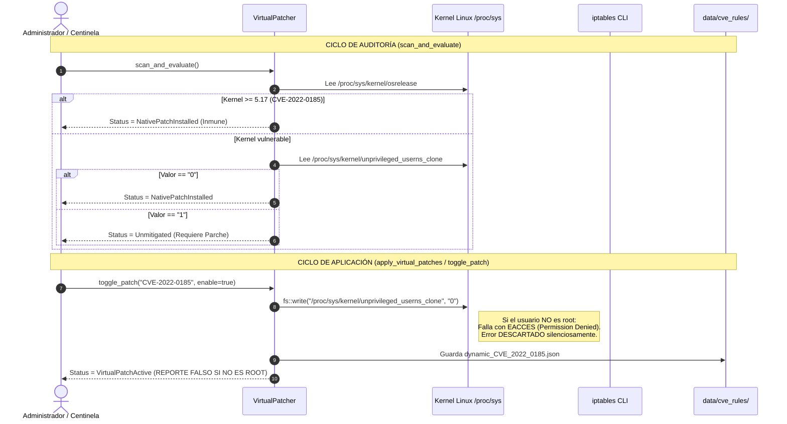

# 02 — Arquitectura Actual del Módulo de Parchado Virtual

**Documento:** `docs/virtual-patching-audit/02-current-architecture.md`  
**Crate:** `crates/samulibre-patcher`  
**Dependencias Clave:** `samulibre-types`, `samulibre-ai`, `chrono`, `serde`, `serde_json`, `anyhow`, `tracing`  

---

## 1. Topología de Componentes del Módulo

El módulo `samulibre-patcher` reside en el workspace de Rust de SamuLibre y se relaciona con el resto del ecosistema a través del siguiente grafo de dependencias:



---

## 2. Modelos de Datos Centrales

Los modelos de datos definidos en [`crates/samulibre-types/src/lib.rs`](file:///home/saghet/Documents/SamulibreLinux/crates/samulibre-types/src/lib.rs) y [`crates/samulibre-patcher/src/lib.rs`](file:///home/saghet/Documents/SamulibreLinux/crates/samulibre-patcher/src/lib.rs):

### 2.1 `VirtualPatchRule`
```rust
pub struct VirtualPatchRule {
    pub id: String,                         // Ej: "VP-LINUX-USERNS" o "VP-AI-CVE_2021_34527"
    pub cve: String,                        // Ej: "CVE-2022-0185"
    pub title: String,                      // Descripción corta
    pub description: String,                // Detalles técnicos
    pub severity: Severity,                 // Critical | High | Medium | Low
    pub target_component: String,           // Ej: "kernel.unprivileged_userns_clone" o "tcpip.sys"
    pub required_kb: Vec<String>,           // Ej: ["USN-5252"] o ["KB5041585"]
    pub strategy: MitigationStrategy,       // Estrategia de remediación
    pub status: PatchStatus,                // Estado de la regla
    pub detected_at: Option<DateTime<Utc>>,
    pub patched_at: Option<DateTime<Utc>>,
    pub unpatched_at: Option<DateTime<Utc>>,
    pub status_reason: Option<String>,
}
```

### 2.2 `MitigationStrategy`
Enum que define la acción supuestamente ejecutada:
1. `NetworkFirewall { rule_name, port, protocol, direction }`: Llama a `iptables` en Linux o `netsh` en Windows.
2. `RegistryHardening { key_path, value_name, safe_value, revert_value }`: Modifica llaves de registro de Windows con `reg.exe`.
3. `ServiceMitigation { service_name, startup_type }`: Cambia el modo de inicio de un servicio de Windows con `sc.exe`.
4. `BehavioralBlock { target_process, forbidden_call }`: Supuesto bloqueo por comportamiento (en la práctica solo un log `info!`).
5. `KernelSysctlHardening { parameter, safe_value, revert_value }`: Escribe en `/proc/sys/...` en Linux.
6. `AndroidTunPacketFilter`: Exclusivo para el wrapper de Android VPN Service.
7. `AndroidPermissionRevoke`: Exclusivo para Android.
8. `AndroidOverlayGuard`: Exclusivo para Android.

---

## 3. Ciclo de Vida Teórico vs. Ciclo de Vida Real de una Regla

A continuación se compara el flujo esperado de un sistema de Virtual Patching frente a lo que realmente ocurre en el código actual:



---

## 4. Trazabilidad de la Cadena de Suministro de Reglas

La auditoría exigió evaluar las etapas:
`FUENTE DE INTELIGENCIA → VALIDACIÓN → NORMALIZACIÓN → ALMACENAMIENTO → ACTIVACIÓN → MOTOR DE PROTECCIÓN → DETECCIÓN → MITIGACIÓN → REGISTRO → INTERFAZ`.

A continuación se detalla el estado de implementación de cada etapa en el código actual:

| Etapa | Estado | Implementación en Código | Evidencia en Archivo |
|---|:---:|---|---|
| **1. Fuente de Inteligencia** | ⚠️ **Parcial** | Catálogo embebido en código (5 reglas fijas para Linux) y lectura de `data/kbs/catalog.json` (6 KBs de Windows). No hay ingesta de NVD, CISA KEV ni distros. | `crates/samulibre-patcher/src/lib.rs#L206-L303` |
| **2. Validación** | ❌ **Inexistente** | No hay validación de firmas digitales, hashes criptográficos ni esquemas JSON estrictos al leer `data/cve_rules/`. | `crates/samulibre-patcher/src/lib.rs#L780-L834` |
| **3. Normalización** | ⚠️ **Parcial** | Mapea estructuras a `VirtualPatchRule`, pero no normaliza identificadores de paquetes, CPEs ni CVSS v3.1/v4.0. | `crates/samulibre-types/src/lib.rs#L93-L110` |
| **4. Almacenamiento** | ⚠️ **Básico** | Archivos JSON sueltos en `data/cve_rules/dynamic_*.json`. Sin base de datos relacional, sin transacciones atómicas y sin control de concurrencia. | `crates/samulibre-patcher/src/lib.rs#L1010-L1017` |
| **5. Activación** | ❌ **Deficiente** | Cambia una bandera en memoria (`rule.status = VirtualPatchActive`). Si la escritura a nivel del SO falla, la bandera se marca como activa de todos modos. | `crates/samulibre-patcher/src/lib.rs#L640-L649` |
| **6. Motor de Protección** | ❌ **Ausente** | **No existe motor de protección en tiempo real.** No hay demonio eBPF, no hay filtro de paquetes L7, no hay interceptor VFS para CVEs. Solo llamadas CLI o sysctl puntual. | `crates/samulibre-patcher/src/lib.rs#L1469-L1550` |
| **7. Detección de Ataque** | ❌ **Ausente** | El sistema no tiene capacidad de detectar si un exploit está ocurriendo (ej. un payload de PwnKit ejecutándose o un paquete IPv6 malicioso). | `crates/samulibre-patcher/src/lib.rs#L1529` |
| **8. Mitigación** | ⚠️ **Parcial / Insegura** | Modifica sysctls globales o agrega reglas iptables. Si se apaga o reinicia el equipo, los cambios en `/proc/sys` se pierden (no persisten en `/etc/sysctl.d/`). | `crates/samulibre-patcher/src/lib.rs#L1536` |
| **9. Registro de Eventos** | ⚠️ **Rudimentario** | Registra eventos simples en arrays en memoria (`auto_patched_history`, `daily_check_log.json`). Sin integración con syslog, journald o auditd. | `crates/samulibre-patcher/src/lib.rs#L745` |
| **10. Interfaz** | ⚠️ **Desacoplada** | El panel visual muestra interruptores ("apple-switch") que cambian de color independientemente del éxito o fracaso del kernel subyacente. | `data/ui/index.html#L514-L525` |

---

## 5. Análisis del Subsistema del Centinela de CVEs

El método `run_sentinel_audit_cycle()` ([`src/lib.rs#L729-L756`](file:///home/saghet/Documents/SamulibreLinux/crates/samulibre-patcher/src/lib.rs#L729-L756)) se invoca periódicamente cada 15 minutos en un hilo secundario:

1. Evalúa el sistema llamando a `scan_and_evaluate()`.
2. Si `auto_patch_enabled == true`, recorre las reglas con severidad `Critical` o `High`.
3. Llama a `enforce_mitigation_helper()`.
4. Si retorna `Ok(())` (lo cual ocurre **siempre**, incluso con fallos de permisos porque los errores se descartan internamente), asume éxito y agrega una entrada a `auto_patched_history`.

**Conclusión Arquitectónica:** El subsistema carece de un canal de retroalimentación bidireccional con el sistema operativo que confirme el estado operativo real de las mitigaciones aplicadas.
