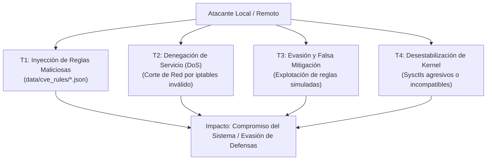

# 05 — Evaluación de Seguridad del Propio Módulo (Security Assessment)

**Documento:** `docs/virtual-patching-audit/05-security-assessment.md`  
**Objetivo:** Auditar la seguridad defensiva, riesgos de abuso, elevación de privilegios y estabilidad introducidos por el módulo `samulibre-patcher`.

---

## 1. Análisis de Amenazas contra el Módulo



---

## 2. Hallazgos de Seguridad por Vector

### 2.1 Vector 1: Manipulación de Reglas Dinámicas en Disco (`data/cve_rules/`)
- **Vulnerabilidad:** El método `load_dynamic_cve_rules()` ([`src/lib.rs#L781-L834`](file:///home/saghet/Documents/SamulibreLinux/crates/samulibre-patcher/src/lib.rs#L781-L834)) lee y deserializa cualquier archivo `.json` presente en `data/cve_rules/`.
- **Riesgo:**
  1. **Falta de Validación Criptográfica:** No se exige firma digital Ed25519 ni hash HMAC que certifique que la regla proviene de SamuLibre oficial.
  2. **Permisos del Directorio:** Si el directorio `data/cve_rules` tiene permisos de escritura para usuarios locales estándar (o si una aplicación vulnerable tiene acceso de escritura a la carpeta de datos), un atacante puede depositar una regla maliciosa.
  3. **Inyección de Parámetros de Red:** Una regla JSON manipulada podría definir:
     ```json
     "strategy": {
       "NetworkFirewall": {
         "rule_name": "BackdoorDrop",
         "port": 22,
         "protocol": "tcp",
         "direction": "in"
       }
     }
     ```
     Provocando una denegación de servicio inmediata bloqueando el acceso administrativo SSH al servidor.

---

### 2.2 Vector 2: Denegación de Servicio a Nivel de Kernel (Sysctls)
- **Vulnerabilidad:** La estrategia `KernelSysctlHardening` permite escribir cualquier valor de texto en cualquier ruta de `/proc/sys/...`.
- **Riesgo:**
  - Si un feed externo o una regla mal estructurada introduce un parámetro de memoria como `vm.max_map_count=0` o `kernel.panic=1`, la aplicación de la regla puede provocar un **Kernel Panic**, la caída instantánea del sistema operativo o el bloqueo de aplicaciones que dependen de user namespaces (como contenedores Docker, Podman o Flatpak al alterar `unprivileged_userns_clone`).
- **Severidad:** **ALTA**

---

### 2.3 Vector 3: Reglas de Firewall Inseguras con `iptables`
- **Vulnerabilidad:** Las reglas de firewall se aplican mediante invocaciones directas a `/usr/bin/iptables` usando `-I INPUT ... -j DROP`.
- **Riesgo:**
  - `iptables` es un mecanismo legacy en Linux moderno. En distribuciones contemporáneas (Garuda/Arch con Linux 6.x/7.x, Ubuntu 24.04, RHEL 9), el subsistema estándar es **`nftables`** con backend `nf_tables`.
  - El uso de llamadas de texto a `iptables` genera conflictos con administradores de firewall nativos como `firewalld`, `ufw` o gestores de red como `NetworkManager`, pudiendo romper la tabla de filtrado o dejar reglas fantasmas que no se limpian al desinstalar.
- **Severidad:** **MEDIA**

---

### 2.4 Vector 4: Fallo de Principio de Privilegio Mínimo
- **Vulnerabilidad:** Actualmente no hay separación entre el proceso que analiza los KBs (que corre como el usuario de escritorio) y el proceso que escribe en `/proc/sys` o ejecuta `iptables`.
- **Riesgo:** Si para que el parchado virtual funcione se exige ejecutar toda la interfaz gráfica (`samulibre-gui`) con `sudo`, se expone el motor gráfico WebView, WebKit/Wry y el renderizador a privilegios de root, lo cual viola el principio de diseño de seguridad de Linux y abre la puerta a escapes de sandbox con privilegios máximos.

---

## 3. Matriz de Resiliencia ante Fallos

| Escenario | Comportamiento Actual | Comportamiento Esperado | Estado |
|---|---|---|:---:|
| **Interrupción de actualización de reglas** | Archivos incompletos pueden quedar en `data/cve_rules/` sin validación atómica. | Escritura en staging temporal `.tmp` con sustitución atómica vía `rename()`. | ❌ Inseguro |
| **Conflicto entre dos reglas** | La última regla sobreescribe silenciosamente el parámetro sysctl de la anterior. | Detección de colisiones y notificación al operador con resolución de prioridades. | ❌ Inseguro |
| **Reinicio del servidor / equipo** | Las mitigaciones en `/proc/sys` se pierden por completo. | Persistencia en `/etc/sysctl.d/` y restauración automática en el arranque vía systemd. | ❌ Inseguro |
| **Pérdida de privilegios root** | La mitigación falla silenciosamente y el estado se marca como "Activo". | La mitigación se marca como "Fallida por Permisos Insuficientes" y se solicita elevación polkit. | ❌ Inseguro |
| **Regla que bloquea tráfico legítimo** | El comando de reversión asume `INPUT`; si era `OUTPUT`, no se puede revertir. | Reversión atómica y rollback con comprobación de estado de red. | ❌ Inseguro |
