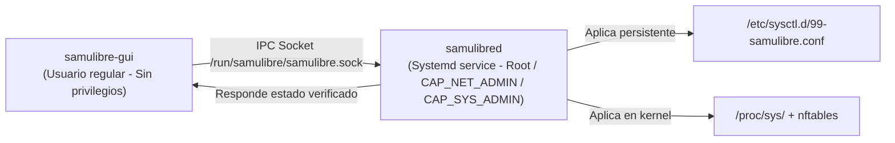

# 07 — Compatibilidad Multi-Distribución Linux

**Documento:** `docs/virtual-patching-audit/07-linux-compatibility.md`  
**Objetivo:** Análisis técnico de requerimientos, dependencias y comportamiento del módulo de parchado virtual en las familias Debian/Ubuntu, Red Hat/Fedora y Arch/Garuda.

---

## 1. Matriz de Distribuciones Objetivo

| Criterio | Ubuntu (22.04 / 24.04 LTS) | Red Hat / Rocky / Alma / Fedora | Garuda Linux / Arch Linux |
|---|---|---|---|
| **Gestor de Paquetes** | `apt` / `dpkg` | `dnf` / `rpm` | `pacman` |
| **Módulo de Seguridad del Kernel (LSM)** | **AppArmor** (activo por omisión) | **SELinux** (Enforcing por omisión) | AppArmor opcional / LSM Yama |
| **Subsistema de Firewall Primario** | `nftables` (con wrapper `iptables-nft`) | `firewalld` (con backend `nftables`) | `nftables` / `iptables` |
| **Kernel Estándar** | 5.15 / 6.8 generic | 5.14 / 6.x enterprise | 6.x / 7.x zen / rolling |
| **Fuente de Avisos de Seguridad** | **Ubuntu Security Notices (USN)** | **Red Hat Security Advisories (RHSA)** | **Arch Linux Security Advisories (ASA)** |
| **Integración con eBPF** | BTF (`/sys/kernel/btf/vmlinux`) activo | BTF activo en RHEL 8.2+ y 9.x | BTF activo en todos los kernels oficiales |

---

## 2. Análisis por Ecosistema

### 2.1 Ecosistema Ubuntu / Debian
- **Mecanismos Disponibles:**
  - `AppArmor`: Permite definir perfiles para confinar binarios propensos a explotación (ej. `pkexec`, navegadores, servidores web).
  - `sysctl`: `/etc/sysctl.d/99-samulibre.conf`.
  - `ufw` / `nftables`: Invocación mediante ganchos directos.
- **Riesgos y Limitaciones:**
  - `iptables legacy` está en desuso; invocar `iptables` directamente puede interferir con reglas gestionadas por `ufw` o Docker.
  - La verificación de paquetes debe usar la base de datos de `dpkg` (`/var/lib/dpkg/status`) y la API local de `libapt-pkg` o CLI `dpkg-query -W -f='${Version}' <paquete>`.

### 2.2 Ecosistema Red Hat / Enterprise Linux (RHEL, Rocky, Alma, Fedora)
- **Mecanismos Disponibles:**
  - `SELinux`: La ejecución de mitigaciones no debe intentar desactivar SELinux ni relajar políticas booleanas globales (`setsebool`). Las mitigaciones deben integrarse mediante módulos de política CIL o reglas de red de `firewalld`.
  - `dnf updateinfo`: Permite consultar erratas y boletines RHSA instalados mediante:
    ```bash
    dnf updateinfo list security installed
    ```
- **Riesgos y Limitaciones:**
  - En entornos con FIPS habilitado o SELinux estricto, la escritura de sysctls arbitrarios o la inserción de reglas de red sin registrar en firewalld genera denegaciones AVC (`type=AVC msg=audit(...)`).

### 2.3 Ecosistema Garuda / Arch Linux
- **Mecanismos Disponibles:**
  - Modelo *Rolling Release*: Las actualizaciones de paquetes y kernel se liberan en cuestión de horas tras el parche upstream.
  - Por esta razón, el kernel zen (ej. `7.2.11-zen1-1-zen`) ya incorpora de forma nativa la práctica totalidad de las mitigaciones que en sistemas de ciclo fijo (LTS) tardan meses en llegar.
  - Base de datos de vulnerabilidades: Arch Linux Security Tracker (`https://security.archlinux.org/issues.json` o herramienta `arch-audit`).
- **Riesgos y Limitaciones:**
  - El software nunca debe asumir que una versión menor de kernel pequeña (ej. `7.2`) es más antigua que `5.17`. El parser semántico debe comparar `(major, minor, patch)` numéricamente.

---

## 3. Modelo de Privilegios y Separación de Procesos

Para operar de forma limpia en las tres distribuciones sin requerir que la interfaz visual se ejecute con `sudo`, la arquitectura debe respetar la separación estricta:



1. **`samulibre-gui` y `samulibre-cli` (modo usuario):**
   - Solo leen telemetría y solicitan acciones al demonio a través del socket UNIX autenticado (`SO_PEERCRED`).
2. **`samulibred` (demonio del sistema):**
   - Ejecuta las acciones privilegiadas con capacidades acotadas: `CAP_NET_ADMIN` (para nftables) y `CAP_SYS_ADMIN` (para sysctl/eBPF).
   - Valida criptográficamente la orden antes de aplicarla.
   - Si el demonio no está activo, la GUI muestra un aviso de elevación Polkit (`org.samulibre.patcher.apply`).
