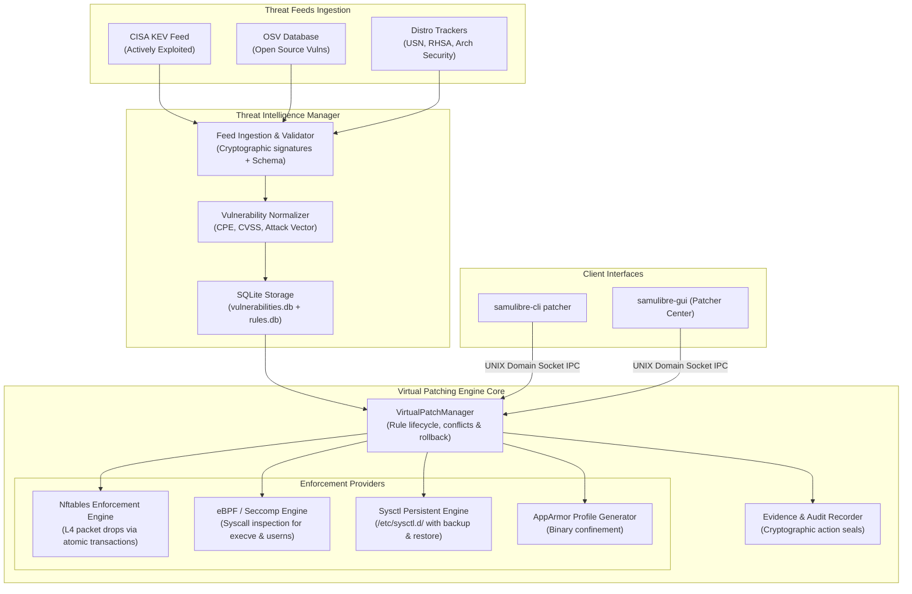

# 08 — Arquitectura Recomendada: Motor de Parchado Virtual Industrial (V2)

**Documento:** `docs/virtual-patching-audit/08-recommended-architecture.md`  
**Objetivo:** Especificación técnica del nuevo diseño modular, desacoplado y 100% nativo para Linux.

---

## 1. Diagrama de la Arquitectura Propuesta



---

## 2. Descripción de los Subsistemas

### 2.1 Módulo de Inventario de Vulnerabilidades (`VulnerabilityInventory`)
- **Responsabilidad:** Descubrir qué paquetes y versiones de software están instalados en el endpoint.
- **Implementación:**
  - Adaptador Debian/Ubuntu: Lee `/var/lib/dpkg/status` o ejecuta `dpkg-query`.
  - Adaptador Red Hat: Lee la base de datos RPM vía `librpm` o `rpm -qa --qf`.
  - Adaptador Arch/Garuda: Lee `/var/lib/pacman/local/`.
  - Adaptador Kernel: Lee `/proc/sys/kernel/osrelease` y compila una estructura semántica `KernelVersion { major, minor, patch, distro_tag }`.
- **Salida:** Inventario tipado `InstalledPackage { name, version, architecture, vendor }`.

---

### 2.2 Motor de Reglas y Ciclo de Vida (`RuleEngine`)
- **Responsabilidad:** Gestionar las reglas de mitigación asegurando que nunca se apliquen reglas incompatibles, expiradas o contradictorias.
- **Propiedades de las Reglas V2:**
  - **Firma Criptográfica:** Toda regla descargada de feeds externos debe contener una firma digital Ed25519 verificada con la clave pública de SamuLibre.
  - **Idempotencia y Transaccionalidad:** Aplicar una regla dos veces no debe duplicar entradas en el firewall ni en los archivos de configuración.
  - **Capacidad de Rollback Garantizada:** Toda regla debe incluir su procedimiento exacto de desmontaje.
  - **Detección de Conflictos:** Si una regla bloquea el puerto 80 y otra regla intenta abrirlo o redirigirlo, el motor detecta el conflicto antes de tocar el kernel.

---

### 2.3 Proveedores de Aplicación de Mitigación (Enforcement Providers)

#### A. Proveedor de Red (`NftablesProvider`)
- Utiliza la biblioteca oficial `nftables` de Linux en lugar de ejecutar subprocesos de texto con `iptables`.
- Crea una tabla dedicada `table inet samulibre_vpatch {}` con una cadena `chain input { type filter hook input priority -10; }`.
- Permite aplicar y retirar reglas de forma **atómica**: si falla una regla, toda la transacción se revierte (`rollback`) sin dejar la tabla a medio configurar.

#### B. Proveedor de Llamadas al Sistema (`EbpfSyscallProvider`)
- Para CVEs locales como `PwnKit` (CVE-2021-4034) o `Looney Tunables` (CVE-2023-4911):
  - Inyecta un programa eBPF en el punto de traza `sys_enter_execve`.
  - Inspecciona los punteros de argumentos y variables de entorno (`argv` y `envp`).
  - Si detecta variables maliciosas conocidas (`GCONV_PATH=` o `GLIBC_TUNABLES=` malformados), deniega la llamada al sistema (`-EPERM`) y emite una alerta forense instantánea al EDR.

#### C. Proveedor de Hardening Persistente (`PersistentSysctlProvider`)
- Escribe las modificaciones en `/etc/sysctl.d/99-samulibre-vpatch.conf`.
- Ejecuta `sysctl --system` para cargar los cambios de inmediato en `/proc/sys/`.
- Mantiene una copia de seguridad en `/etc/sysctl.d/.samulibre-backup.conf` para revertir los valores exactos que tenía el administrador antes de instalar SamuLibre.

---

### 2.4 Centro de Evidencias Técnicas (`PatchAuditCenter`)
- Todo evento de análisis, aplicación, fallo o reversión genera un registro inmutable en SQLite:
  ```sql
  CREATE TABLE patch_evidence (
      id TEXT PRIMARY KEY,
      cve TEXT NOT NULL,
      rule_id TEXT NOT NULL,
      action TEXT NOT NULL, -- 'APPLIED', 'REVERTED', 'FAILED', 'COLLISION'
      provider TEXT NOT NULL, -- 'nftables', 'ebpf', 'sysctl'
      exit_code INTEGER,
      error_message TEXT,
      system_state_hash TEXT NOT NULL,
      created_at TEXT NOT NULL
  );
  ```
- Este registro permite exportar certificados forenses en HTML/JSON que demuestran qué mitigación estuvo activa en cada segundo de operación.
