# 09 — Plan de Trabajo Priorizado por Fases: Modernización V2

**Documento:** `docs/virtual-patching-audit/09-work-plan.md`  
**Objetivo:** Guía operativa de desarrollo con tareas específicas, criterios de aceptación, pruebas y dependencias.

---

## 1. Resumen de Fases y Cronograma

```mermaid
gantt
    title Plan de Modernización del Parchado Virtual (SamuLibre V2)
    dateFormat  X
    axisFormat %d

    section Fase 0: Estabilización
    P0-1 Eliminar fallos silenciosos y errores ignorados :0, 2
    P0-2 Retirar mitigación simulada BehavioralBlock :1, 3

    section Fase 1: Purga y Arquitectura
    P1-1 Purgar modelos y catálogos de Windows :2, 4
    P1-2 Crear módulos de inventario de paquetes Linux :3, 6

    section Fase 2: Motores de Mitigación
    P2-1 Motor persistente sysctl (/etc/sysctl.d) :5, 8
    P2-2 Motor de red nftables atómico :7, 10
    P2-3 Sonda eBPF para intercepción de execve :8, 12

    section Fase 3: Feeds de Inteligencia
    P3-1 Conectores CISA KEV y OSV API :10, 13
    P3-2 Conectores de avisos de distros (USN/RHSA) :12, 15

    section Fase 4: Experiencia de Usuario
    P4-1 Rediseño honesto de interfaz (sin falsos verdes) :14, 17
    P4-2 Subcomandos CLI avanzados de parchado :15, 18

    section Fase 5: QA y Certificación
    P5-1 Pruebas de regresión y empaquetado multi-distro :17, 20
```

---

## 2. Desglose Detallado de Tareas

### FASE 0 — Estabilización Inmediata y Eliminación de Riesgos

#### Tarea P0-1: Eliminación de Fallos Silenciosos y Manejo Estricto de Errores
- **ID:** `VPATCH-001`
- **Descripción:** Reemplazar todas las sentencias `let _ = ...` en `enforce_mitigation_helper` y `revert_mitigation_helper` por comprobación estricta de códigos de salida (`status.success()`) y propagación de errores mediante `Result<()>`.
- **Problema que Resuelve:** Evita que el sistema marque una regla como `VirtualPatchActive` cuando la escritura en sysctl o iptables falló por falta de permisos de root (`EACCES`).
- **Archivos Afectados:** `crates/samulibre-patcher/src/lib.rs` (líneas 1469-1617).
- **Dependencias:** Ninguna.
- **Prioridad:** **P0 (Crítica)** | **Complejidad:** Baja | **Riesgo:** Bajo.
- **Criterios de Aceptación:** Si un comando falla, la función retorna `Err(anyhow::anyhow!(...))` y el estado de la regla pasa a `PatchStatus::Failed { reason }`.
- **Pruebas:** `test_mitigation_failure_without_root` (ejecutado como usuario sin privilegios).

#### Tarea P0-2: Retiro de Mitigaciones Simuladas (`BehavioralBlock`)
- **ID:** `VPATCH-002`
- **Descripción:** Modificar el manejador de `MitigationStrategy::BehavioralBlock` para que, en lugar de emitir un log informativo y retornar `Ok(())`, retorne formalmente un error indicando que la estrategia no está disponible en modo espacio de usuario o redirigirla al motor EDR si está presente.
- **Problema que Resuelve:** Elimina la falsa sensación de protección en vulnerabilidades como PwnKit (CVE-2021-4034).
- **Archivos Afectados:** `crates/samulibre-patcher/src/lib.rs` (líneas 1529-1531).
- **Dependencias:** `VPATCH-001`.
- **Prioridad:** **P0 (Crítica)** | **Complejidad:** Baja | **Riesgo:** Bajo.
- **Criterios de Aceptación:** Ninguna regla simulada puede reportarse como activa sin una barrera real comprobable en el sistema.

---

### FASE 1 — Purga de Windows y Refactorización Arquitectónica

#### Tarea P1-1: Purga Definitiva de Componentes y Modelos de Windows
- **ID:** `VPATCH-003`
- **Descripción:** Eliminar del crate `samulibre-patcher` las funciones y referencias exclusivas de Windows: `load_windows_cve_catalog`, `get_installed_kbs` (vía powershell), `fetch_pending_windows_updates` (vía COM WUA), `get_windows_os_info` (vía reg.exe) y los archivos en `data/kbs/catalog.json` y `data/cve_rules/` que corresponden a Microsoft Windows.
- **Problema que Resuelve:** Elimina código muerto, deuda técnica y el riesgo de que la IA genere reglas con `powershell.exe` para Linux.
- **Archivos Afectados:** `crates/samulibre-patcher/src/lib.rs`, `data/kbs/catalog.json`, `data/cve_rules/*.json`.
- **Dependencias:** `VPATCH-001`.
- **Prioridad:** **P1 (Alta)** | **Complejidad:** Media | **Riesgo:** Bajo.
- **Criterios de Aceptación:** El workspace compila limpiamente sin advertencias y sin una sola referencia a KBs de Windows Update en la ruta de ejecución de Linux.

#### Tarea P1-2: Módulo de Inventario de Paquetes Multi-Distribución
- **ID:** `VPATCH-004`
- **Descripción:** Crear el submódulo `package_inventory.rs` capaz de consultar los paquetes instalados en:
  - Ubuntu/Debian (`dpkg-query -W -f='${Package} ${Version}\n'`).
  - Red Hat/Fedora/Rocky (`rpm -qa --qf '%{NAME} %{VERSION}-%{RELEASE}\n'`).
  - Garuda/Arch (`pacman -Q`).
- **Problema que Resuelve:** Permite conocer qué paquetes realmente están instalados para determinar qué CVEs afectan al equipo sin falsos positivos.
- **Archivos Afectados:** `crates/samulibre-patcher/src/package_inventory.rs` (nuevo archivo).
- **Dependencias:** `VPATCH-003`.
- **Prioridad:** **P1 (Alta)** | **Complejidad:** Media | **Riesgo:** Bajo.
- **Criterios de Aceptación:** Retorna una lista estructurada de paquetes instalados en menos de 100 ms.

---

### FASE 2 — Motores Reales de Mitigación (Enforcement Engines)

#### Tarea P2-1: Motor de Hardening Persistente de Parámetros Sysctl
- **ID:** `VPATCH-005`
- **Descripción:** Implementar persistencia real para `KernelSysctlHardening`:
  1. Escribir `/etc/sysctl.d/99-samulibre-vpatch.conf`.
  2. Aplicar de inmediato con `sysctl --system`.
  3. Crear archivo de respaldo `/etc/sysctl.d/.samulibre-backup.conf`.
  4. Método `revert` que restaura el valor original previo.
- **Problema que Resuelve:** Pérdida de mitigaciones tras reiniciar el equipo.
- **Archivos Afectados:** `crates/samulibre-patcher/src/sysctl_engine.rs` (nuevo archivo).
- **Dependencias:** `VPATCH-001`.
- **Prioridad:** **P1 (Alta)** | **Complejidad:** Media | **Riesgo:** Medio.
- **Criterios de Aceptación:** Tras reiniciar el sistema o ejecutar `sysctl --system`, los parámetros mitigados permanecen activos.

#### Tarea P2-2: Motor de Filtrado Atómico con Nftables
- **ID:** `VPATCH-006`
- **Descripción:** Reemplazar las invocaciones de `iptables` por una integración estructurada con `nftables` creando una tabla aislada `samulibre_vpatch`.
- **Problema que Resuelve:** Compatibilidad con distribuciones modernas y prevención de conflictos con `firewalld` o `ufw`.
- **Archivos Afectados:** `crates/samulibre-patcher/src/nftables_engine.rs` (nuevo archivo).
- **Dependencias:** `VPATCH-003`.
- **Prioridad:** **P2 (Media)** | **Complejidad:** Alta | **Riesgo:** Medio.
- **Criterios de Aceptación:** Transacciones atómicas: si una regla de red falla, ninguna regla queda en estado inconsistente.

#### Tarea P2-3: Sonda eBPF para Intercepción de Execve (Mitigación LPE)
- **ID:** `VPATCH-007`
- **Descripción:** Conectar el módulo de parchado virtual con el subsistema eBPF de `samulibre-shield` / `samulibre-watcher` para interceptar llamadas al sistema `sys_enter_execve` y denegar ejecuciones que contengan variables maliciosas de explotación (ej. `GCONV_PATH=` para CVE-2021-4034 o `GLIBC_TUNABLES=` para CVE-2023-4911).
- **Problema que Resuelve:** Convierte el parchado de vulnerabilidades locales de Linux en una defensa activa real en lugar de un log informativo.
- **Archivos Afectados:** `crates/samulibre-patcher/src/ebpf_vpatch.rs`, `crates/samulibre-shield/src/ebpf_telemetry.rs`.
- **Dependencias:** `VPATCH-002`.
- **Prioridad:** **P2 (Media)** | **Complejidad:** Alta | **Riesgo:** Medio.
- **Criterios de Aceptación:** Un exploit de prueba de PwnKit es abortado inmediatamente con `-EPERM` y se genera una evidencia forense.

---

### FASE 3 — Feeds de Inteligencia y Automatización

#### Tarea P3-1: Ingesta Automática de CISA KEV y OSV Database
- **ID:** `VPATCH-008`
- **Descripción:** Implementar el módulo `threat_feeds.rs` para descargar periódicamente la lista oficial de CISA KEV (vulnerabilidades explotadas activamente en la naturaleza) y correlacionarlas con los paquetes instalados detectados por `package_inventory.rs`.
- **Problema que Resuelve:** Elimina la dependencia de un catálogo estático de 5 CVEs.
- **Archivos Afectados:** `crates/samulibre-patcher/src/threat_feeds.rs`.
- **Dependencias:** `VPATCH-004`.
- **Prioridad:** **P2 (Media)** | **Complejidad:** Media | **Riesgo:** Bajo.
- **Criterios de Aceptación:** Descarga, valida y almacena en SQLite los CVEs activos con su vector de ataque y score CVSS.

---

### FASE 4 — Interfaz Gráfica Honesta y Subcomandos CLI

#### Tarea P4-1: Rediseño del Centro de Parchado en la GUI
- **ID:** `VPATCH-009`
- **Descripción:** En `data/ui/index.html`:
  - Eliminar textos de Windows ("KBs Microsoft", "WUA", "tcpip.sys").
  - Modificar los interruptores para que solo se pongan verdes cuando el backend responda con `PatchStatus::VirtualPatchActive` verificado.
  - Añadir pestaña de "Evidencia Criptográfica" mostrando el comando exacto o regla nftables aplicada.
- **Problema que Resuelve:** Elimina la desalineación visual y los falsos verdes.
- **Archivos Afectados:** `data/ui/index.html`, `crates/samulibre-gui/src/main.rs`.
- **Dependencias:** `VPATCH-001`, `VPATCH-005`.
- **Prioridad:** **P1 (Alta)** | **Complejidad:** Media | **Riesgo:** Bajo.

---

### FASE 5 — Pruebas de Regresión y Certificación Multi-Distro

#### Tarea P5-1: Suite Completa de Pruebas de Mitigación y Empaquetado
- **ID:** `VPATCH-010`
- **Descripción:** Diseñar pruebas unitarias y de integración que verifiquen el ciclo de vida completo: aplicación, persistencia, reversión y tolerancia a fallos en Ubuntu, RHEL y Garuda.
- **Archivos Afectados:** `crates/samulibre-patcher/src/lib.rs`, `tests/vpatch_integration.rs`.
- **Dependencias:** Todas las tareas previas.
- **Prioridad:** **P1 (Alta)** | **Complejidad:** Media | **Riesgo:** Bajo.
